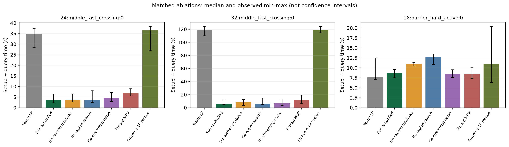
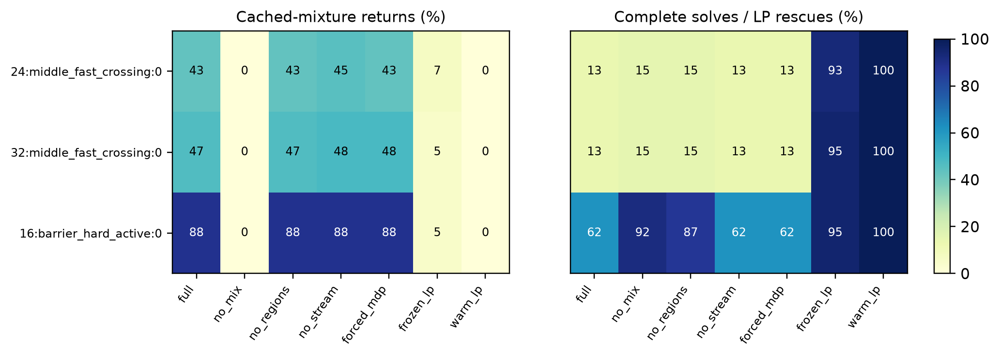
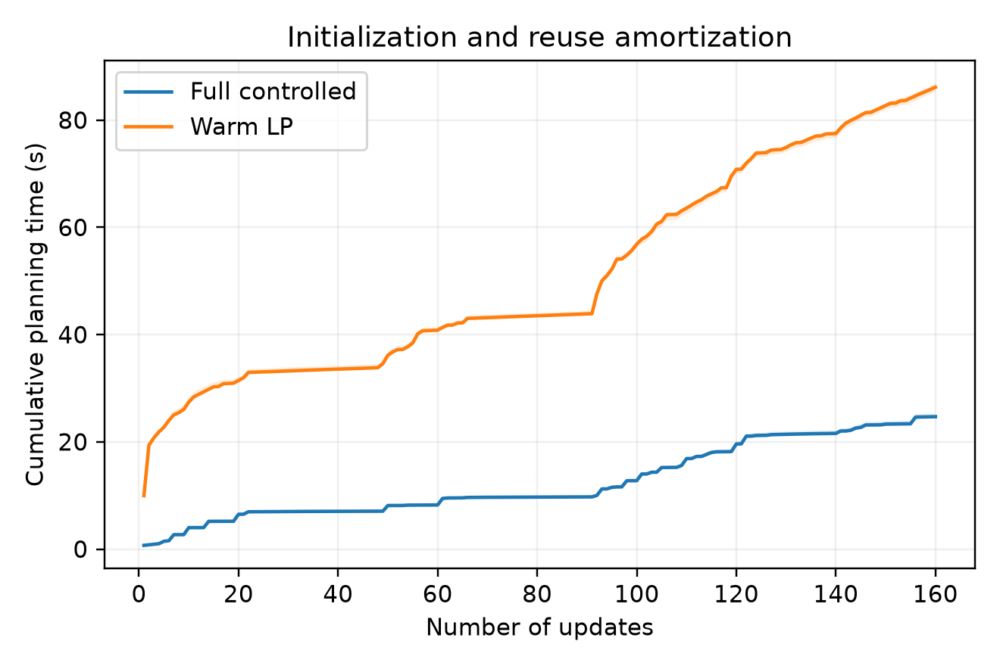
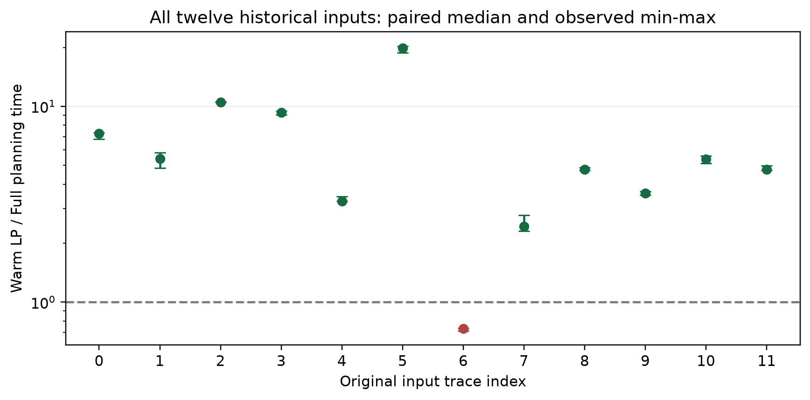
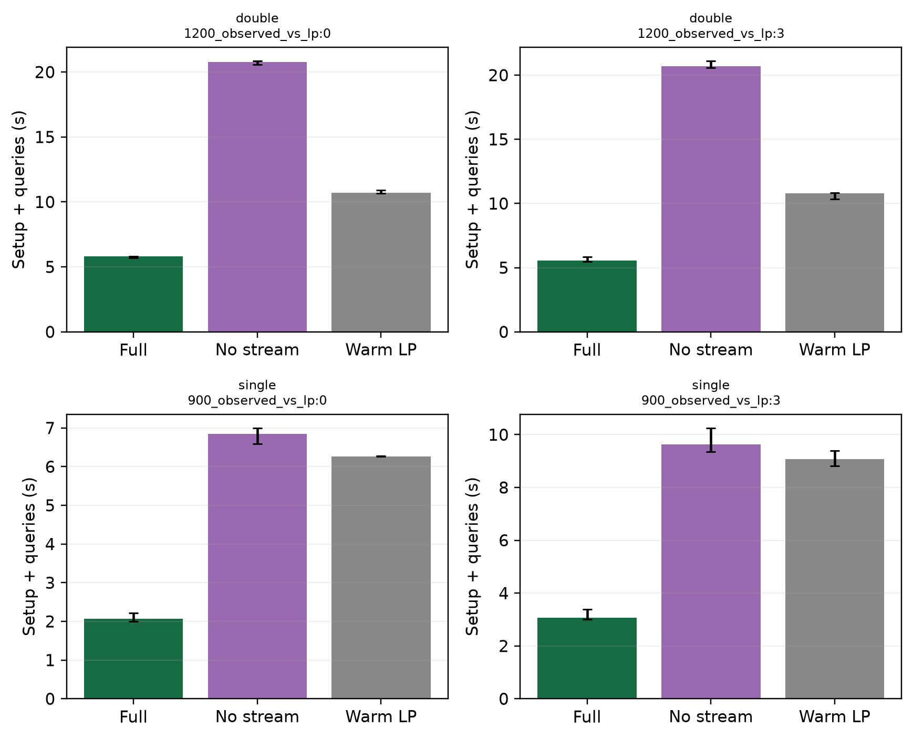
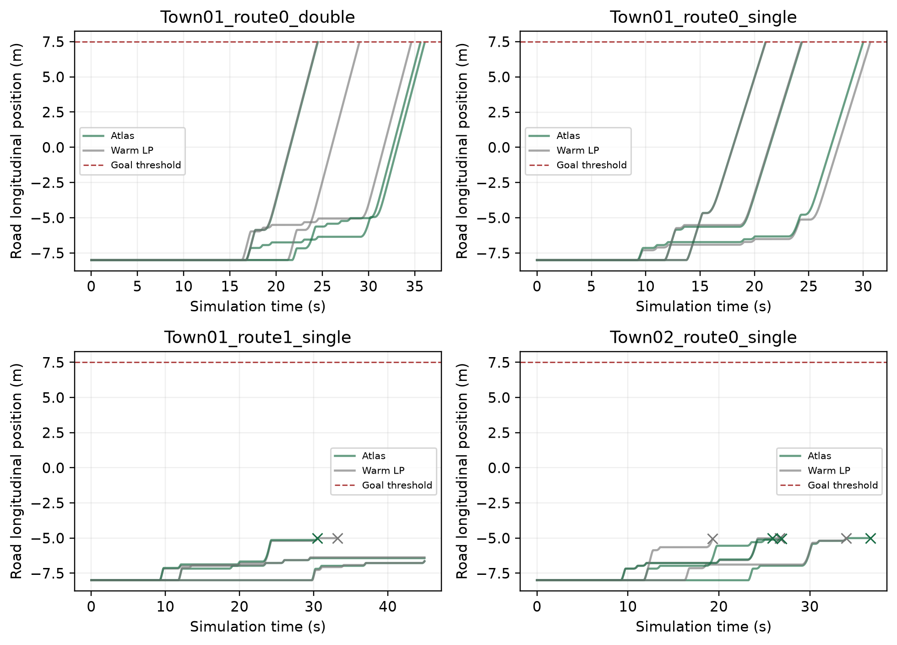
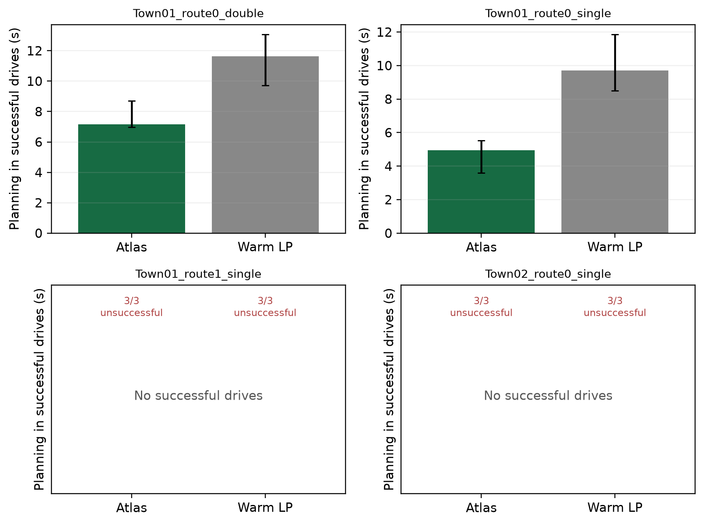
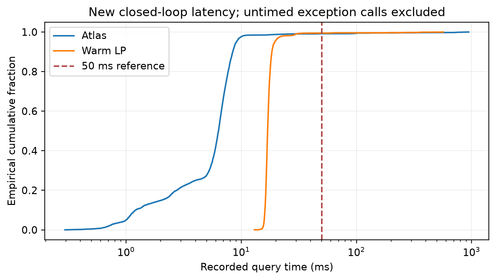

# 修订证书后的受控消融、重复统计和 CARLA 扩展实验

这是本团队在原作者代码快照目录下新增的实验产出，不属于 IROS 原作者的原始实现。基线快照为 `1dced97`；本目录包含新运行的原始记录、核验、绘图代码及环境信息。旧版计时不与本批数据合并。图片入口及建议图注见 [FIGURES_CN.md](FIGURES_CN.md)。

## 1 实验口径与有效范围

- 固定产品转移、标签与 LTL 任务，仅更新局部风险代价；回放另外更新起点。γ=0.8，软预算 S=1，硬预算 H=2。
- 主实验 3 个输入序列种子，每个种子重复计时 3 次。三次计时不是三个独立道路场景；表中中位数及最小—最大范围仅作描述统计，不作为置信区间。
- 各方法在独立新进程中顺序执行，顺序由固定随机种子打乱；包含自身初始化和返回策略的查询成本，排除公共模型构建、Python 导入和独立策略评价。
- 控制 OpenBLAS/OMP/MKL 与 HiGHS 为单线程。LP 保留模型和 simplex basis；原始/对偶可行性容差为 1e-9。
- `full` 是统一受控驱动中的完整组合，复用生产实现的策略生成和残差上界；它并非历史闭环程序查询路径的逐行副本，其时间不得替换历史原始计时。
- 硬预算压力例人为放大奖励，属于辅助压力测试；不能解释为 CARLA 风险已校准。
- 风险和目标差证书针对高层模型的期望折扣指标；浮点残差检查不是区间算术的机器严格证明。

## 2 消融定义

| 版本 | 唯一主要变化 |
|---|---|
| full | 缓存组合、区域价格检索、流式上界复用和按需扩充全部开启 |
| no_mix | 禁止缓存确定策略之间的占据分布混合；完整 CMDP 回退仍可返回随机策略，保持原优化问题不变 |
| no_regions | 不求策略区域端点，改用 0、1、源价格与上次价格计算有效残差上界；扩充规则相同 |
| no_stream | 不使用单调上界档案或上次区域快速路径，每次扫描策略库 |
| forced_mdp | 每次先求一个普通标量化 MDP，再认证及必要扩充 |
| frozen_lp | 只保留初始化策略库；未认证时用持久化 LP 救援，不再扩充策略库；属于诊断性替代机制 |
| warm_lp | 每次使用保基 LP 重优化，并恢复非负概率策略 |

`forced_mdp` 的 direct_hit 是强制求 MDP 后认证成功，不能解释为免求解的缓存命中。no_regions 只关闭在线缓存区域查询，完整 CMDP 生成器内部的断点搜索保持不变。策略组合字段为 primal_i、primal_j、primal_weight；仅不同索引且权重严格介于 0 和 1 时计入实际组合。

## 3 主消融结果

| 模型 | 方法 | 运行数 | 累计时间中位数 [最小, 最大] / 秒 | 缓存组合返回数 | 完整求解数 | 查询失败数 |
|---|---|---:|---:|---:|---:|---:|
| 24:middle_fast_crossing:0 | warm_lp | 9 | 34.912 [28.569, 37.485] | 0 | 180 | 0 |
| 24:middle_fast_crossing:0 | full | 9 | 3.627 [2.395, 6.501] | 78 | 24 | 0 |
| 24:middle_fast_crossing:0 | no_mix | 9 | 3.781 [2.827, 6.617] | 0 | 27 | 0 |
| 24:middle_fast_crossing:0 | no_regions | 9 | 3.650 [2.497, 8.069] | 78 | 27 | 0 |
| 24:middle_fast_crossing:0 | no_stream | 9 | 4.563 [2.975, 7.167] | 81 | 24 | 0 |
| 24:middle_fast_crossing:0 | forced_mdp | 9 | 7.017 [5.573, 8.995] | 78 | 24 | 0 |
| 24:middle_fast_crossing:0 | frozen_lp | 9 | 36.801 [26.952, 38.438] | 12 | 168 | 0 |
| 32:middle_fast_crossing:0 | warm_lp | 9 | 118.757 [110.249, 124.577] | 0 | 180 | 0 |
| 32:middle_fast_crossing:0 | full | 9 | 6.257 [4.808, 12.024] | 84 | 24 | 0 |
| 32:middle_fast_crossing:0 | no_mix | 9 | 8.207 [3.393, 12.689] | 0 | 27 | 0 |
| 32:middle_fast_crossing:0 | no_regions | 9 | 6.357 [4.967, 15.211] | 84 | 27 | 0 |
| 32:middle_fast_crossing:0 | no_stream | 9 | 6.708 [3.548, 13.328] | 87 | 24 | 0 |
| 32:middle_fast_crossing:0 | forced_mdp | 9 | 11.711 [6.226, 19.308] | 87 | 24 | 0 |
| 32:middle_fast_crossing:0 | frozen_lp | 9 | 118.584 [114.667, 124.181] | 9 | 171 | 0 |
| 16:barrier_hard_active:0 | warm_lp | 9 | 7.703 [7.065, 12.449] | 0 | 180 | 0 |
| 16:barrier_hard_active:0 | full | 9 | 8.721 [7.524, 9.587] | 159 | 111 | 0 |
| 16:barrier_hard_active:0 | no_mix | 9 | 10.998 [10.506, 11.376] | 0 | 165 | 0 |
| 16:barrier_hard_active:0 | no_regions | 9 | 12.696 [10.855, 13.453] | 159 | 156 | 0 |
| 16:barrier_hard_active:0 | no_stream | 9 | 8.426 [7.621, 9.563] | 159 | 111 | 0 |
| 16:barrier_hard_active:0 | forced_mdp | 9 | 8.471 [7.309, 10.057] | 159 | 111 | 0 |
| 16:barrier_hard_active:0 | frozen_lp | 9 | 11.015 [6.332, 20.423] | 9 | 171 | 0 |

### 配对时间与成本归因

- 24:middle_fast_crossing:0：9 组配对计时中完整方法较快 9 组；LP/完整方法时间比中位数 9.61，范围 [5.36, 12.21]。这不是独立道路场景成功率。
  - no_mix/完整方法的配对时间比中位数 1.03，范围 [0.87, 1.61]；大于 1 表示关闭/替换该机制后更慢，小于 1 表示完整方法在相应运行没有时间优势。
  - no_regions/完整方法的配对时间比中位数 1.04，范围 [0.80, 1.34]；大于 1 表示关闭/替换该机制后更慢，小于 1 表示完整方法在相应运行没有时间优势。
  - no_stream/完整方法的配对时间比中位数 1.12，范围 [0.91, 1.57]；大于 1 表示关闭/替换该机制后更慢，小于 1 表示完整方法在相应运行没有时间优势。
  - forced_mdp/完整方法的配对时间比中位数 1.96，范围 [1.38, 2.33]；大于 1 表示关闭/替换该机制后更慢，小于 1 表示完整方法在相应运行没有时间优势。
- 32:middle_fast_crossing:0：9 组配对计时中完整方法较快 9 组；LP/完整方法时间比中位数 18.06，范围 [9.88, 24.40]。这不是独立道路场景成功率。
  - no_mix/完整方法的配对时间比中位数 1.05，范围 [0.67, 1.42]；大于 1 表示关闭/替换该机制后更慢，小于 1 表示完整方法在相应运行没有时间优势。
  - no_regions/完整方法的配对时间比中位数 1.06，范围 [1.02, 1.30]；大于 1 表示关闭/替换该机制后更慢，小于 1 表示完整方法在相应运行没有时间优势。
  - no_stream/完整方法的配对时间比中位数 1.11，范围 [0.53, 1.21]；大于 1 表示关闭/替换该机制后更慢，小于 1 表示完整方法在相应运行没有时间优势。
  - forced_mdp/完整方法的配对时间比中位数 1.61，范围 [1.25, 2.08]；大于 1 表示关闭/替换该机制后更慢，小于 1 表示完整方法在相应运行没有时间优势。
- 16:barrier_hard_active:0：9 组配对计时中完整方法较快 4 组；LP/完整方法时间比中位数 0.97，范围 [0.74, 1.47]。这不是独立道路场景成功率。
  - no_mix/完整方法的配对时间比中位数 1.27，范围 [1.15, 1.45]；大于 1 表示关闭/替换该机制后更慢，小于 1 表示完整方法在相应运行没有时间优势。
  - no_regions/完整方法的配对时间比中位数 1.40，范围 [1.21, 1.66]；大于 1 表示关闭/替换该机制后更慢，小于 1 表示完整方法在相应运行没有时间优势。
  - no_stream/完整方法的配对时间比中位数 0.99，范围 [0.90, 1.10]；大于 1 表示关闭/替换该机制后更慢，小于 1 表示完整方法在相应运行没有时间优势。
  - forced_mdp/完整方法的配对时间比中位数 0.97，范围 [0.90, 1.05]；大于 1 表示关闭/替换该机制后更慢，小于 1 表示完整方法在相应运行没有时间优势。





速度差异须结合各序列的配对结果、缓存组合次数和完整求解次数解释；不将某一模块在全部场景中都有效作为预设结论。
从主实验可区分两类证据：局部变化且缓存能覆盖新参数时，复用减少重复求解；硬约束压力例中，频繁扩充抵消部分收益。区域检索、流式上界和缓存组合的价值取决于序列，不宜将整套方法相对 LP 的收益全部归于其中一个模块。受控消融改变组件也可能改变后续生成的策略库，测得的是组件在整个序列中的总影响，而非单次查询的孤立耗时。

论文贡献归因还需区分求解结构与复用机制：完整方法相对保基 LP 的总收益同时包含标量化求解器和缓存复用的差异，不能全部归因于图谱创新。forced_mdp 与完整方法共享底层求解及认证，更直接检验“是否需要每次先求 MDP”的作用；但它本身仍保留图谱，因此也不是完全无缓存算法。策略组合在风险带中减少了少量完整求解，而在硬约束压力例中的独立作用更明显；这些结果支持条件性贡献，不能声称每个模块都带来大幅或稳定加速。

## 4 支持范围、变化幅度、拓扑及长序列

| 模型 / 更新方式 | 支持维数 | 幅度 | 查询数 | 方法 | 时间中位数 / 秒 | 最大缓存策略数 | 最大缓存数组与 LU / MiB |
|---|---:|---:|---:|---|---:|---:|---:|
| 24:middle_fast_varied:1 / walk | 5 | 0.8 | 20 | full | 0.595 | 2 | 7.59 |
| 24:middle_fast_varied:1 / walk | 5 | 0.8 | 20 | warm_lp | 14.431 | 0 | 0.00 |
| 24:middle_fast_crossing:0 / walk | 5 | 0.2 | 20 | full | 1.947 | 11 | 37.53 |
| 24:middle_fast_crossing:0 / walk | 5 | 0.2 | 20 | warm_lp | 63.149 | 0 | 0.00 |
| 24:middle_fast_crossing:0 / iid | 5 | 0.8 | 20 | full | 7.540 | 23 | 79.35 |
| 24:middle_fast_crossing:0 / iid | 5 | 0.8 | 20 | warm_lp | 50.079 | 0 | 0.00 |
| 24:middle_fast_crossing:0 / walk | 1 | 0.8 | 20 | full | 1.646 | 8 | 16.05 |
| 24:middle_fast_crossing:0 / walk | 1 | 0.8 | 20 | warm_lp | 32.352 | 0 | 0.00 |
| 24:middle_fast_crossing:0 / walk | 3 | 0.8 | 20 | full | 4.925 | 19 | 52.25 |
| 24:middle_fast_crossing:0 / walk | 3 | 0.8 | 20 | warm_lp | 34.792 | 0 | 0.00 |
| 24:middle_fast_crossing:0 / walk | 5 | 0.8 | 160 | full | 24.685 | 62 | 212.62 |
| 24:middle_fast_crossing:0 / walk | 5 | 0.8 | 160 | warm_lp | 86.129 | 0 | 0.00 |



数组与 LU 列只计图谱缓存，不计 LP 模型和基，因此 warm_lp 的此列为 0 不代表 LP 不占内存。该列也不包含全部 Python/SuperLU 对象开销。RSS 为采样进程内存，并包含为独立核验保存的返回策略，不应称为纯规划器内存或操作系统严格峰值。长序列中的有限增长情况不能代替长期容量界或均摊复杂度证明。
小幅变化 0.2 序列的保基 LP 每次重复均发生一次冷重建，其成本已经包含在表中；该行不能作为“风险变化越小，LP 越慢”的一般规律。所有计时仅对应本机与所列软件版本。

### 原十二条输入序列的整套复测

按原 run_paper_atlas_suite.py 的全部十二组模型、更新方式和种子，重新运行受控 full 与保基 LP，每组各三次计时、每次 20 查询。包含原奖励放大的压力例和已知不占优输入；不沿用旧版 11/12 结论。这里只复用旧输入，不把新受控驱动称为旧实现逐行复现。

| 原编号 | 模型 / 更新 / 种子 | Full 中位数 [最小, 最大] / 秒 | LP 中位数 [最小, 最大] / 秒 | 配对 LP/Full 中位数 | 查询失败数 |
|---:|---|---:|---:|---:|---:|
| 0 | 24:middle_fast_crossing:0 / walk / 73044 | 4.333 [4.141, 4.412] | 30.474 [30.075, 31.443] | 7.26 | 0 |
| 1 | 24:middle_fast_crossing:0 / iid / 73044 | 6.683 [6.569, 7.376] | 36.196 [35.777, 38.166] | 5.42 | 0 |
| 2 | 32:middle_fast_crossing:0 / walk / 73044 | 9.069 [9.043, 9.207] | 95.397 [95.240, 96.587] | 10.52 | 0 |
| 3 | 32:middle_fast_crossing:0 / iid / 73044 | 13.740 [13.718, 14.211] | 128.712 [128.066, 129.700] | 9.32 | 0 |
| 4 | 24:middle_fast_varied:0 / iid / 73045 | 8.427 [8.400, 8.466] | 27.787 [27.609, 29.088] | 3.28 | 0 |
| 5 | 24:middle_fast_varied:17 / walk / 73046 | 0.563 [0.542, 0.595] | 11.139 [11.019, 11.188] | 19.80 | 0 |
| 6 | 16:barrier_hard_active:0 / iid / 73047 | 9.817 [9.801, 10.124] | 7.202 [6.997, 7.401] | 0.73 | 0 |
| 7 | 16:barrier_hard_active:1 / walk / 73048 | 2.186 [1.847, 2.195] | 5.146 [5.071, 5.332] | 2.44 | 0 |
| 8 | 24:barrier_hard_active:0 / iid / 73049 | 28.929 [28.372, 29.043] | 138.088 [136.452, 138.415] | 4.77 | 0 |
| 9 | 24:barrier_hard_active:1 / walk / 73050 | 7.159 [6.983, 7.345] | 25.752 [25.644, 25.795] | 3.60 | 0 |
| 10 | 24:barrier_hard_active:2 / iid / 73051 | 17.277 [16.198, 17.512] | 90.495 [89.780, 92.954] | 5.38 | 0 |
| 11 | 32:barrier_hard_active3:0 / walk / 73050 | 15.106 [14.708, 15.272] | 72.600 [71.324, 72.974] | 4.75 | 0 |
十二条中已配对 12 条，其中 11 条的配对时间比中位数大于 1；这是固定测试集的描述统计，不是道路分布上的提速概率。完整核验见 historical_analysis/audit.json，输入逐条对照见 historical_input_audit.json。




## 5 同观测序列的重新计时

以下输入来自既有四条 CARLA 每 tick 观测序列；此次重新执行求解器计时和独立策略评价，不将它称为新驾驶或把旧回放脚本总耗时当作规划耗时。各方法的 theta 与初始状态序列以 SHA-256 对齐。

| 序列 | 方法 | 计时重复数 | 累计时间中位数 / 秒 | 查询失败数 |
|---|---|---:|---:|---:|
| replay:double_20hz_1200_observed_vs_lp:0 | full | 3 | 5.824 | 0 |
| replay:double_20hz_1200_observed_vs_lp:0 | no_stream | 3 | 20.784 | 0 |
| replay:double_20hz_1200_observed_vs_lp:0 | warm_lp | 3 | 10.706 | 0 |
| replay:double_20hz_1200_observed_vs_lp:3 | full | 3 | 5.540 | 0 |
| replay:double_20hz_1200_observed_vs_lp:3 | no_stream | 3 | 20.694 | 0 |
| replay:double_20hz_1200_observed_vs_lp:3 | warm_lp | 3 | 10.793 | 0 |
| replay:single_20hz_900_observed_vs_lp:0 | full | 3 | 2.063 | 0 |
| replay:single_20hz_900_observed_vs_lp:0 | no_stream | 3 | 6.841 | 0 |
| replay:single_20hz_900_observed_vs_lp:0 | warm_lp | 3 | 6.265 | 0 |
| replay:single_20hz_900_observed_vs_lp:3 | full | 3 | 3.069 | 0 |
| replay:single_20hz_900_observed_vs_lp:3 | no_stream | 3 | 9.630 | 0 |
| replay:single_20hz_900_observed_vs_lp:3 | warm_lp | 3 | 9.066 | 0 |



## 6 新增 CARLA 闭环实验

闭环沿用原 lane-only 高层模型和前进/等待控制，0.05 秒仿真步长，每 tick 查询，每 10 tick 执行动作。各方法经历的轨迹、查询数和到达时刻可能不同，累计计算时间不能直接解释为同输入纯求解器加速或车辆更快到达。

| 配置 | 方法 / 重复 | 到达 | 碰撞 | 规划失败 | 查询记录/计时数 | 已记录累计规划 / 秒 | P95 / 毫秒 | 最慢 / 毫秒 |
|---|---|---|---|---|---:|---:|---:|---:|
| Town01_route0_double | fixed_observed_hybrid / 0 | True | False | None | 722/722 | 7.150 | 9.54 | 912.03 |
| Town01_route0_double | fixed_warm_lp / 0 | True | False | None | 693/693 | 13.065 | 18.58 | 544.82 |
| Town01_route0_double | fixed_warm_lp / 1 | True | False | None | 581/581 | 11.643 | 21.74 | 534.34 |
| Town01_route0_double | fixed_observed_hybrid / 1 | True | False | None | 713/713 | 8.699 | 9.97 | 902.84 |
| Town01_route0_double | fixed_observed_hybrid / 2 | True | False | None | 491/491 | 6.983 | 9.88 | 945.27 |
| Town01_route0_double | fixed_warm_lp / 2 | True | False | None | 490/490 | 9.714 | 20.76 | 550.85 |
| Town01_route0_single | fixed_observed_hybrid / 0 | True | False | None | 421/421 | 3.594 | 8.46 | 460.09 |
| Town01_route0_single | fixed_warm_lp / 0 | True | False | None | 421/421 | 8.507 | 19.73 | 569.01 |
| Town01_route0_single | fixed_warm_lp / 1 | True | False | None | 614/614 | 11.851 | 19.08 | 548.33 |
| Town01_route0_single | fixed_observed_hybrid / 1 | True | False | None | 601/601 | 5.538 | 9.49 | 734.30 |
| Town01_route0_single | fixed_observed_hybrid / 2 | True | False | None | 488/488 | 4.937 | 8.39 | 756.13 |
| Town01_route0_single | fixed_warm_lp / 2 | True | False | None | 487/487 | 9.700 | 18.76 | 549.20 |
| Town01_route1_single | fixed_observed_hybrid / 0 | False | False | None | 900/900 | 5.396 | 8.57 | 341.73 |
| Town01_route1_single | fixed_warm_lp / 0 | False | False | None | 900/900 | 16.166 | 20.11 | 357.08 |
| Town01_route1_single | fixed_warm_lp / 1 | False | False | RuntimeError: Infeasible | 666/665 | 12.135 | 19.09 | 356.51 |
| Town01_route1_single | fixed_observed_hybrid / 1 | False | False | RuntimeError: Layer policy iteration did not converge | 612/611 | 4.709 | 7.56 | 765.15 |
| Town01_route1_single | fixed_observed_hybrid / 2 | False | False | None | 900/900 | 6.423 | 8.41 | 744.34 |
| Town01_route1_single | fixed_warm_lp / 2 | False | False | None | 900/900 | 15.937 | 18.82 | 351.15 |
| Town02_route0_single | fixed_observed_hybrid / 0 | False | False | RuntimeError: Layer policy iteration did not converge | 735/734 | 5.622 | 9.20 | 376.18 |
| Town02_route0_single | fixed_warm_lp / 0 | False | False | RuntimeError: Infeasible | 682/681 | 12.287 | 18.89 | 361.80 |
| Town02_route0_single | fixed_warm_lp / 1 | False | False | RuntimeError: Infeasible | 536/535 | 9.984 | 19.10 | 338.69 |
| Town02_route0_single | fixed_observed_hybrid / 1 | False | False | RuntimeError: Layer policy iteration did not converge | 540/539 | 5.247 | 8.65 | 823.02 |
| Town02_route0_single | fixed_observed_hybrid / 2 | False | False | RuntimeError: Layer policy iteration did not converge | 520/519 | 4.980 | 8.20 | 830.33 |
| Town02_route0_single | fixed_warm_lp / 2 | False | False | RuntimeError: Infeasible | 388/387 | 7.573 | 19.92 | 357.61 |



进度图的横轴为仿真时间，纵轴为道路纵向位置，虚线为到达阈值；叉号标记发生规划异常前最后一个已记录位置。累计规划时间柱图仅汇总成功到达且无碰撞、无规划失败的驾驶，失败次数在对应子图标明，全部驾驶仍列于上表。





记录 24 次驾驶，其中到达 12 次，碰撞 0 次，规划失败 8 次；超过 50 ms 的已记录查询共 107 次。不同方法走过不同轨迹，以上次数仅描述本批记录。
新增驾驶轨迹另作不计时的独立复核：24 条轨迹中，14993 个已返回策略的观测点全部通过=True；另有 8 次未返回策略的规划失败单独保留，不计为证书通过或驾驶成功。两种方法均检查相同输入下重建结果与驾驶记录的一致性及独立策略评价；图谱另与 LP 核对证书上下界。记录只保存前进概率而非完整动作分布，因此一致性检查不能等同于逐元素比对原完整策略。详见 new_carla_validation/audit.json。
上述所有重建策略另外逐状态检查动作概率非负和概率和为 1；最小概率与最大行和误差记录在各轨迹 summary 中。

规划异常处的额外新建 LP 诊断：Town01_route1_single / fixed_warm_lp / tick 665：Infeasible；Town01_route1_single / fixed_observed_hybrid / tick 611：Infeasible；Town02_route0_single / fixed_observed_hybrid / tick 734：Infeasible；Town02_route0_single / fixed_warm_lp / tick 681：Infeasible；Town02_route0_single / fixed_warm_lp / tick 535：Infeasible；Town02_route0_single / fixed_observed_hybrid / tick 539：Infeasible；Town02_route0_single / fixed_observed_hybrid / tick 519：Infeasible；Town02_route0_single / fixed_warm_lp / tick 387：Infeasible。LP 的 Infeasible 是数值求解器分类，并非精确算术不可行证明。
Town01 路线 1 与 Town02 中的超时及异常表明：当前高层模型与前进/等待低层控制不能保证所有道路上完成任务。即使每次已返回策略均满足模型内证书，也可能进入后续模型不可行的状态，或因执行与策略动作空间不完全对应而停滞。这限制了闭环推广结论，不能仅凭未记录碰撞宣称安全且完成了任务。
硬风险压力例的额外非计时核验中，60 个点有 38 个同时满足风险处于硬预算边界且硬风险对偶乘子为正。该检查用于确认约束确实发挥作用，不增加独立场景数。

原闭环脚本的异常查询行未保存 plan_s，因此失败驾驶的累计时间不包含异常调用的完整成本，不能用于速度胜负结论。P95、最慢延迟和延迟分布仅计算已保存耗时的查询，不将异常行当作零耗时；表内同时列出查询记录数与有计时数。
仿真同步 20 Hz 不等于墙钟严格实时；应同时查看尾延迟和超过 50 ms 的次数。未到达、初始化失败、碰撞及规划失败均保留，不因不利结果从统计中删除。高层证书不构成连续轨迹碰撞概率或完整滚动 LTL 满足性的证明。

## 7 数值核验与修复

正式合成/敏感性批次已完成 225 组、5340 条查询记录；审计异常 0 条，缺少配对 LP 的运行 0 组。详见 analysis/audit.json。
固定序列回放完成 36 组、22113 条记录；审计异常 0 条。
原十二条输入的整套复测另完成 72 组、1440 条查询，独立统计于 historical_analysis；不与主消融合并计算场景数。
每次返回检查风险、目标差、动作概率合法性和独立策略评价；与相同参数 LP 的目标进行上下界交叉核查。预设的验证阈值未因失败记录而放宽。
诊断发现 LP 可行性容差允许微小负占据量。直接归一化可将它们在近零访问状态放大为负动作概率。非负截断后再归一化解决了该问题，并增加回归测试。默认容差试验与修复前计时全部排除于正式表格；numerical_pilot.json 保留问题证据。
小幅变化序列中保基 LP 曾出现 HiGHS Not Set 状态；重置基仍失败时，现按相同精度和线程配置冷重建当前 LP，代价计入该次查询。相关三组计时整段重跑，原失败记录保留在 diagnostics/lp_notset_before_cold_rebuild。单方向更新的生成器原先尝试不放回抽取两个方向，已修正为至多抽取实际方向数；六组受影响运行重新执行，原错误记录亦保留。
新增驾驶的首轮复核脚本因同名 benchmark 模块导入顺序，误用默认硬预算 5，与驾驶的硬预算 2 不一致，导致重建记录不匹配。现于导入前显式固定并断言 γ=0.8、S=1、H=2，复核整套重新执行；误配置的复核仅保留在 diagnostics/wrong_validation_import_context，不进入本报告有效核验数。原始驾驶、受控消融和固定回放脚本在运行前已显式固定这些参数，不受该复核脚本错误影响。
已完成 48 个所有消融分支的独立 LP/策略核验，以及原实现 30 个标量化上界、50 个缓存凸包 LP 和 40 个方向迁移上界检查。方向迁移功能不被归因为本批未启用的主实验收益。

## 8 复现

建议 Python 3.11，依赖版本见 requirements-run.txt；CARLA 服务端与客户端为 0.9.16。

```bash
python check_probability_recovery.py
python check_recorded_lp_recovery.py
python check_controlled.py
python run_suite.py
python analyze_results.py
python run_historical_suite.py
python check_historical_inputs.py
python analyze_results.py --results historical_results --out historical_analysis --expected 72
python run_replay_suite.py
python analyze_results.py --results replay_results --out replay_analysis --expected 36
# 先单独启动 CARLA 服务端，关闭其他计时进程，再执行：
python run_carla_suite.py
# 计时结束后单独进行正确性复核与绘图：
python validate_new_carla.py
python check_failed_carla_queries.py
python check_hard_activity.py
python plot_supplement.py
python write_report.py
```

代码从仓库相对目录导入实现；原始记录的 command 字段含本机路径，可按当前仓库位置调整。所有 CSV、JSON、图与报告均应从同一批完成的结果生成。

## 9 仍需区分的研究问题

这些补实验增加了成本归因、重复统计和适用边界证据，不能自动证明方法新颖性，也不能替代与参数 LP、策略列生成和 CMDP 复用工作的系统比较。风险映射仍为研究者设定，闭环低层精化和长期缓存容量控制仍是限制。
