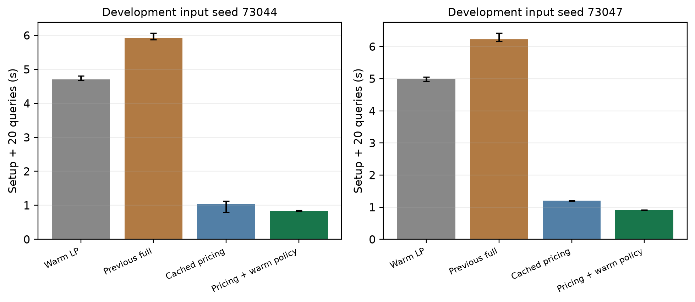
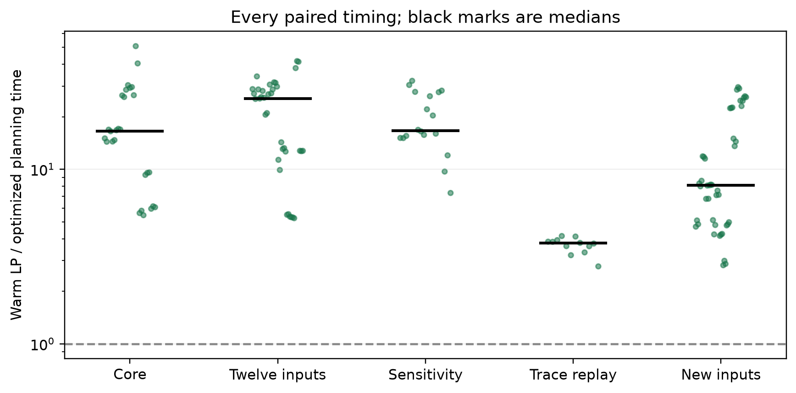
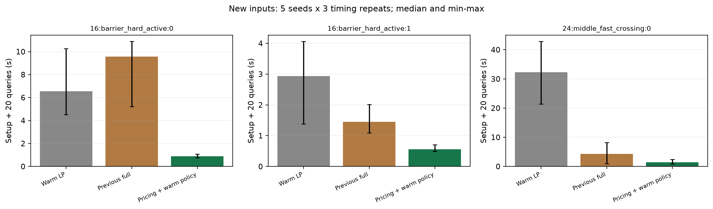
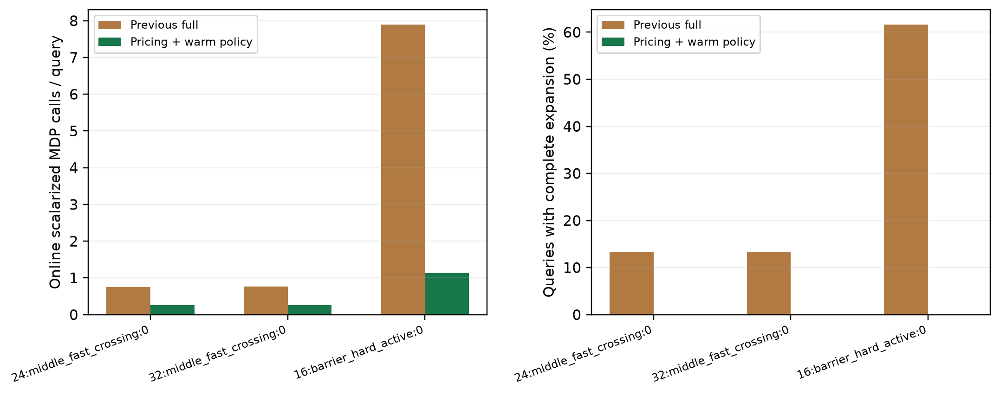
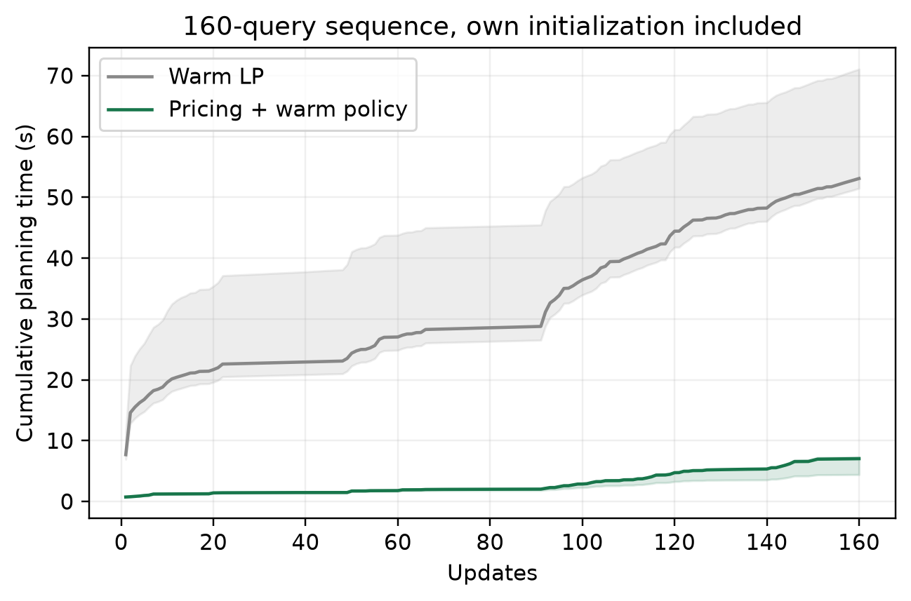

# 缓存对偶定价与策略迭代热启动：优化复测报告

本批改进保留 2026-10-23 代码及全部旧结果。旧批次的 85/93 更快属于旧计时记录；本报告使用当天重新运行的相同保基 LP，分别报告既有输入复测和开发前固定的新输入。图片入口及图注见 [FIGURES_CN.md](FIGURES_CN.md)。

不同日期的机器负载、温度和计时波动可能改变旧版胜负，不能直接把两批胜率之差全归因于代码修改。同日另运行旧版 full 对照，覆盖主实验、旧套件的不占优输入，以及全部新风险序列；优化效果应同时查看这些同日比较。

## 改了什么

压力例剖析显示主要时间花在完整 CMDP 的风险价格搜索和重复普通 MDP 求解。新版从缓存最优占据分布组合的奖励—风险斜率推算候选价格，在当前风险下求解一次普通 MDP，形成有效全局上界并补充策略；仍不够好时继续定价或进入原有验证后的完整扩充。
候选价格只是求解建议，返回仍需通过原来的硬风险与目标差证书。旧策略的动作还可用作策略迭代起点；该收益通过 priced（关闭这个热启动）对照单独观察。
这些修改采用已有的对偶定价、列生成及策略热启动思想，不能仅因本次更快就宣称全新理论。优化实现目前位于统一受控驱动；未替换历史 CARLA 闭环控制器。

## 比较口径

- LP 保留模型与 simplex basis，HiGHS 单线程、原始/对偶可行性容差 1e-9；其他线性代数库也单线程。
- 各方法顺序执行、各次独立进程、顺序固定种子打乱；包含自身初始化和策略恢复，排除公共模型构建、导入与独立策略评价。
- 目标差门槛仍为 max(1e-4, 1%×|返回目标值|)，并保留数值容差；并非近零目标值下的纯相对 1%。
- 开发只用两个已知压力序列。新输入为五个预先指定种子 × 三种配置，每个重复三次；不用于调参。各项计时重复不等于独立道路。

## 配对时间结果

| 批次 | 配对数 | 新版更快 | 新版更慢 | 无效配对 | LP/新版配对比中位数 [最小, 最大] |
|---|---:|---:|---:|---:|---:|
| 主实验 | 27 | 27 | 0 | 0 | 16.52 [5.46, 50.79] |
| 旧十二条输入 | 36 | 36 | 0 | 0 | 25.38 [5.25, 41.69] |
| 敏感性 | 18 | 18 | 0 | 0 | 16.67 [7.32, 32.14] |
| 固定观测回放 | 12 | 12 | 0 | 0 | 3.77 [2.78, 4.15] |
| 留出新风险序列 | 45 | 45 | 0 | 0 | 8.10 [2.82, 29.57] |

配对时间比先对每次相同输入求 LP 时间/新版时间，再取中位数；它不一定等于两种方法各自时间中位数之商。范围为观测最小—最大值，不是置信区间。

既有输入合计 93 次配对，其中新版更快 93 次、较慢 0 次；新输入 45 次配对，更快 45 次、较慢 0 次。它们是固定输入上的计时观察，不能作为一般场景成功概率。

## 分配置时间和求解次数

| 批次 / 配置 | 方法 | 运行数 | 累计时间中位数 [最小, 最大] / 秒 | 在线 MDP 调用总数 | 完整扩充/LP 调用总数 |
|---|---|---:|---:|---:|---:|
| core / 16:barrier_hard_active:0 | full | 9 | 5.174 [4.830, 6.077] | 1422 | 111 |
| core / 16:barrier_hard_active:0 | optimized | 9 | 0.860 [0.829, 0.887] | 204 | 0 |
| core / 16:barrier_hard_active:0 | priced | 3 | 1.039 [0.794, 1.124] | 66 | 0 |
| core / 16:barrier_hard_active:0 | warm_lp | 9 | 5.280 [4.669, 8.056] | 0 | 180 |
| core / 24:middle_fast_crossing:0 | full | 9 | 1.790 [1.631, 3.428] | 135 | 24 |
| core / 24:middle_fast_crossing:0 | optimized | 9 | 1.086 [0.985, 1.377] | 48 | 0 |
| core / 24:middle_fast_crossing:0 | warm_lp | 9 | 18.354 [14.573, 19.867] | 0 | 180 |
| core / 32:middle_fast_crossing:0 | full | 9 | 5.688 [3.188, 5.886] | 138 | 24 |
| core / 32:middle_fast_crossing:0 | optimized | 9 | 2.199 [1.977, 2.732] | 48 | 0 |
| core / 32:middle_fast_crossing:0 | warm_lp | 9 | 60.131 [56.842, 126.720] | 0 | 180 |
| heldout / 16:barrier_hard_active:0 | full | 15 | 9.567 [5.199, 10.893] | 2373 | 183 |
| heldout / 16:barrier_hard_active:0 | optimized | 15 | 0.879 [0.763, 1.067] | 357 | 0 |
| heldout / 16:barrier_hard_active:0 | warm_lp | 15 | 6.557 [4.521, 10.255] | 0 | 300 |
| heldout / 16:barrier_hard_active:1 | full | 15 | 1.453 [1.087, 2.014] | 528 | 57 |
| heldout / 16:barrier_hard_active:1 | optimized | 15 | 0.554 [0.485, 0.709] | 168 | 0 |
| heldout / 16:barrier_hard_active:1 | warm_lp | 15 | 2.933 [1.376, 4.062] | 0 | 300 |
| heldout / 24:middle_fast_crossing:0 | full | 15 | 4.352 [0.947, 8.196] | 345 | 51 |
| heldout / 24:middle_fast_crossing:0 | optimized | 15 | 1.417 [0.816, 2.377] | 159 | 0 |
| heldout / 24:middle_fast_crossing:0 | warm_lp | 15 | 32.259 [21.388, 42.851] | 0 | 300 |
| historical / 16:barrier_hard_active:0 / iid / 73047 / 0.8 / 5 / 20 | full | 3 | 6.222 [6.163, 6.428] | 567 | 42 |
| historical / 16:barrier_hard_active:0 / iid / 73047 / 0.8 / 5 / 20 | optimized | 3 | 0.913 [0.911, 0.919] | 75 | 0 |
| historical / 16:barrier_hard_active:0 / iid / 73047 / 0.8 / 5 / 20 | priced | 3 | 1.205 [1.178, 1.205] | 75 | 0 |
| historical / 16:barrier_hard_active:0 / iid / 73047 / 0.8 / 5 / 20 | warm_lp | 3 | 5.002 [4.924, 5.051] | 0 | 60 |
| historical / 16:barrier_hard_active:1 / walk / 73048 / 0.8 / 5 / 20 | optimized | 3 | 0.728 [0.719, 0.878] | 51 | 0 |
| historical / 16:barrier_hard_active:1 / walk / 73048 / 0.8 / 5 / 20 | warm_lp | 3 | 3.858 [3.822, 4.606] | 0 | 60 |
| historical / 24:barrier_hard_active:0 / iid / 73049 / 0.8 / 5 / 20 | optimized | 3 | 2.055 [2.055, 2.457] | 72 | 0 |
| historical / 24:barrier_hard_active:0 / iid / 73049 / 0.8 / 5 / 20 | warm_lp | 3 | 85.683 [84.915, 93.434] | 0 | 60 |
| historical / 24:barrier_hard_active:1 / walk / 73050 / 0.8 / 5 / 20 | optimized | 3 | 1.230 [1.228, 1.243] | 30 | 0 |
| historical / 24:barrier_hard_active:1 / walk / 73050 / 0.8 / 5 / 20 | warm_lp | 3 | 15.698 [15.676, 15.790] | 0 | 60 |
| historical / 24:barrier_hard_active:2 / iid / 73051 / 0.8 / 5 / 20 | optimized | 3 | 2.081 [1.834, 2.331] | 63 | 0 |
| historical / 24:barrier_hard_active:2 / iid / 73051 / 0.8 / 5 / 20 | warm_lp | 3 | 59.710 [59.310, 62.482] | 0 | 60 |
| historical / 24:middle_fast_crossing:0 / iid / 73044 / 0.8 / 5 / 20 | optimized | 3 | 1.789 [1.517, 1.836] | 36 | 0 |
| historical / 24:middle_fast_crossing:0 / iid / 73044 / 0.8 / 5 / 20 | warm_lp | 3 | 37.738 [37.573, 40.811] | 0 | 60 |
| historical / 24:middle_fast_crossing:0 / walk / 73044 / 0.8 / 5 / 20 | optimized | 3 | 1.178 [1.164, 1.263] | 18 | 0 |
| historical / 24:middle_fast_crossing:0 / walk / 73044 / 0.8 / 5 / 20 | warm_lp | 3 | 31.977 [31.955, 33.538] | 0 | 60 |
| historical / 24:middle_fast_varied:0 / iid / 73045 / 0.8 / 5 / 20 | optimized | 3 | 2.539 [2.109, 2.890] | 66 | 0 |
| historical / 24:middle_fast_varied:0 / iid / 73045 / 0.8 / 5 / 20 | warm_lp | 3 | 30.132 [25.167, 32.755] | 0 | 60 |
| historical / 24:middle_fast_varied:17 / walk / 73046 / 0.8 / 5 / 20 | optimized | 3 | 0.582 [0.579, 0.585] | 0 | 0 |
| historical / 24:middle_fast_varied:17 / walk / 73046 / 0.8 / 5 / 20 | warm_lp | 3 | 7.566 [7.397, 7.703] | 0 | 60 |
| historical / 32:barrier_hard_active3:0 / walk / 73050 / 0.8 / 5 / 20 | optimized | 3 | 3.099 [3.003, 3.159] | 27 | 0 |
| historical / 32:barrier_hard_active3:0 / walk / 73050 / 0.8 / 5 / 20 | warm_lp | 3 | 81.883 [79.585, 84.472] | 0 | 60 |
| historical / 32:middle_fast_crossing:0 / iid / 73044 / 0.8 / 5 / 20 | optimized | 3 | 4.694 [4.523, 4.942] | 42 | 0 |
| historical / 32:middle_fast_crossing:0 / iid / 73044 / 0.8 / 5 / 20 | warm_lp | 3 | 147.210 [141.477, 147.930] | 0 | 60 |
| historical / 32:middle_fast_crossing:0 / walk / 73044 / 0.8 / 5 / 20 | optimized | 3 | 2.244 [2.155, 3.393] | 18 | 0 |
| historical / 32:middle_fast_crossing:0 / walk / 73044 / 0.8 / 5 / 20 | warm_lp | 3 | 61.810 [61.124, 103.745] | 0 | 60 |
| replay / replay:double_20hz_1200_observed_vs_lp:0 | optimized | 3 | 3.036 [2.839, 3.047] | 30 | 0 |
| replay / replay:double_20hz_1200_observed_vs_lp:0 | warm_lp | 3 | 11.662 [11.155, 11.730] | 0 | 2163 |
| replay / replay:double_20hz_1200_observed_vs_lp:3 | optimized | 3 | 3.141 [2.740, 3.531] | 30 | 0 |
| replay / replay:double_20hz_1200_observed_vs_lp:3 | warm_lp | 3 | 11.372 [11.365, 11.404] | 0 | 2142 |
| replay / replay:single_20hz_900_observed_vs_lp:0 | optimized | 3 | 1.705 [1.579, 2.045] | 12 | 0 |
| replay / replay:single_20hz_900_observed_vs_lp:0 | warm_lp | 3 | 6.507 [6.461, 6.833] | 0 | 1263 |
| replay / replay:single_20hz_900_observed_vs_lp:3 | optimized | 3 | 2.572 [2.441, 3.404] | 12 | 0 |
| replay / replay:single_20hz_900_observed_vs_lp:3 | warm_lp | 3 | 9.320 [9.167, 9.460] | 0 | 1803 |
| sensitivity / 24:middle_fast_crossing:0 / iid / 83001 / 0.8 / 5 / 20 | optimized | 3 | 1.957 [1.939, 1.985] | 48 | 0 |
| sensitivity / 24:middle_fast_crossing:0 / iid / 83001 / 0.8 / 5 / 20 | warm_lp | 3 | 31.985 [31.255, 32.943] | 0 | 60 |
| sensitivity / 24:middle_fast_crossing:0 / walk / 83001 / 0.2 / 5 / 20 | optimized | 3 | 1.460 [1.294, 1.621] | 30 | 0 |
| sensitivity / 24:middle_fast_crossing:0 / walk / 83001 / 0.2 / 5 / 20 | warm_lp | 3 | 45.050 [39.377, 46.924] | 0 | 60 |
| sensitivity / 24:middle_fast_crossing:0 / walk / 83001 / 0.8 / 1 / 20 | optimized | 3 | 0.934 [0.916, 1.001] | 12 | 0 |
| sensitivity / 24:middle_fast_crossing:0 / walk / 83001 / 0.8 / 1 / 20 | warm_lp | 3 | 20.353 [20.226, 24.499] | 0 | 60 |
| sensitivity / 24:middle_fast_crossing:0 / walk / 83001 / 0.8 / 3 / 20 | optimized | 3 | 1.379 [1.361, 1.394] | 36 | 0 |
| sensitivity / 24:middle_fast_crossing:0 / walk / 83001 / 0.8 / 3 / 20 | warm_lp | 3 | 38.441 [22.074, 38.558] | 0 | 60 |
| sensitivity / 24:middle_fast_crossing:0 / walk / 83001 / 0.8 / 5 / 160 | optimized | 3 | 7.034 [4.416, 7.318] | 114 | 0 |
| sensitivity / 24:middle_fast_crossing:0 / walk / 83001 / 0.8 / 5 / 160 | warm_lp | 3 | 53.084 [51.485, 71.054] | 0 | 480 |
| sensitivity / 24:middle_fast_varied:1 / walk / 83001 / 0.8 / 5 / 20 | optimized | 3 | 0.595 [0.594, 0.598] | 0 | 0 |
| sensitivity / 24:middle_fast_varied:1 / walk / 83001 / 0.8 / 5 / 20 | warm_lp | 3 | 9.042 [8.966, 9.244] | 0 | 60 |

MDP 调用列只计在线阶段；累计时间包含各方法自身初始化。完整扩充计数指进入旧完整价格搜索程序，并非宣称新版不求解约束问题；新版定价轮次中的普通 MDP 均计入调用数。LP 行的完整调用计数指 LP 查询。尾延迟、采样 RSS 和每次运行的完整指标见 analysis/run_summary.csv，缓存规模及数据量保存在原始结果。



上图只包含两个开发输入的三次重复，不能当作新序列上的独立消融结论。









## 如何解释

同日旧版对照共 75 次，新版较快 75 次；旧版/新版配对时间比中位数 2.98，范围 [1.13, 12.68]。这比直接比较不同日期的 85/93 与本批胜率更能支持代码改进效果。

在这同一批 75 次输入与重复计时上，旧版相对 LP 为 57 次更快、18 次更慢；新版相对 LP 为 75 次更快。这是已说明的子集，不代表旧版全部 93 次输入的同日胜率。

主实验压力例的在线普通 MDP 调用累计由 1422 次降至 204 次，进入旧完整搜索程序由 111 次降至 0 次。收益主要表现为未命中后更有针对性地补算，不是将所有查询变成零求解缓存命中。

旧十二条中原不占优的开发输入（种子 73047），同日三次计时中位数：旧完整实现 6.222 秒，保基 LP 5.002 秒，仅缓存定价 1.205 秒，加动作热启动 0.913 秒。该例首先由定价减少搜索成本，动作热启动再提供额外收益；这不证明每种输入中热启动都同样有效。

新版实际目标差最大占用了约 80.9% 的允许误差预算，未突破原门槛；它不是声称所有目标值的纯相对误差都等于该百分比。

主要收益候选是未直接复用成功时减少完整价格搜索；不能将普通 MDP 调用减少等同于零求解复用。比较 full、priced 和 optimized 可以区分原完整实现、缓存定价，以及额外策略热启动的影响。若热启动的计时改进不稳定，不能声称其总是有益。
胜负以所有完成且独立核验有效的同输入累计时间比较。失败或未完成配对不计为胜利。所有数据、P95、最大延迟、缓存和内存记录均保留，不能只看胜率。
即使本批全部获胜，也只说明在这些输入、机器和软件版本上获胜。局部更新次数不足、模型改变、缓存维护变贵、风险问题不可行或基线实现更高效，都可能改变结果。没有任意输入下必定快于 LP 的定理。
本批合成配置规模为 16×16 至 32×32，旧作者公开的 4×4 小例子不在这 93 次比较中，未据本批结果宣称该小例子也已提速。新输入是新的风险更新序列，使用的三种模型配置仍与已说明的模型族相同。
本次不运行新 CARLA 驾驶；固定观测回放的计时不能改变旧批次 24 次驾驶中 12 次未到达的结论，也不提供物理碰撞概率或严格实时保证。

## 独立核验

一对原始回放计时与中途 JSON 汇总审计重叠，因此两个方法均在所有其他计时与绘图结束后整对重跑，保持相同输入、代码与门槛。原两份记录保留在 diagnostics/interim_audit_overlap，正式表使用重跑结果而非挑选最好时间；最终保留 357 组，另有这两份被替代的尝试记录。

完成运行 357/357，查询记录 22242；审计异常 0 条，未完成文件 0 个。详见 analysis/audit.json。
逐查询核验动作概率、独立策略目标与风险、硬预算、目标差及相同输入下的 LP 下上界关系；开发先导另外通过 60 次独立 LP/策略检查。
新版有时会比旧完整搜索更早在允许的 1%/绝对目标差门槛内停止，两者承诺的门槛相同，但不能因此宣称返回值精度逐点相等。实际相对 LP 的误差与预算使用比例另见 analysis/quality.json。

## 复现

依赖与原批次相同，Python 3.11，见 ../experiments_20261023/requirements-run.txt。
```bash
python check_pilots.py
python run_suite.py
python analyze.py
python plot_results.py
python write_report.py
```

模型与风险序列从旧脚本导入，旧脚本本身不修改。run_manifest.json 和每份结果保存优化源文件 SHA-256。新输入列表与比较规则见 PROTOCOL_CN.md。
