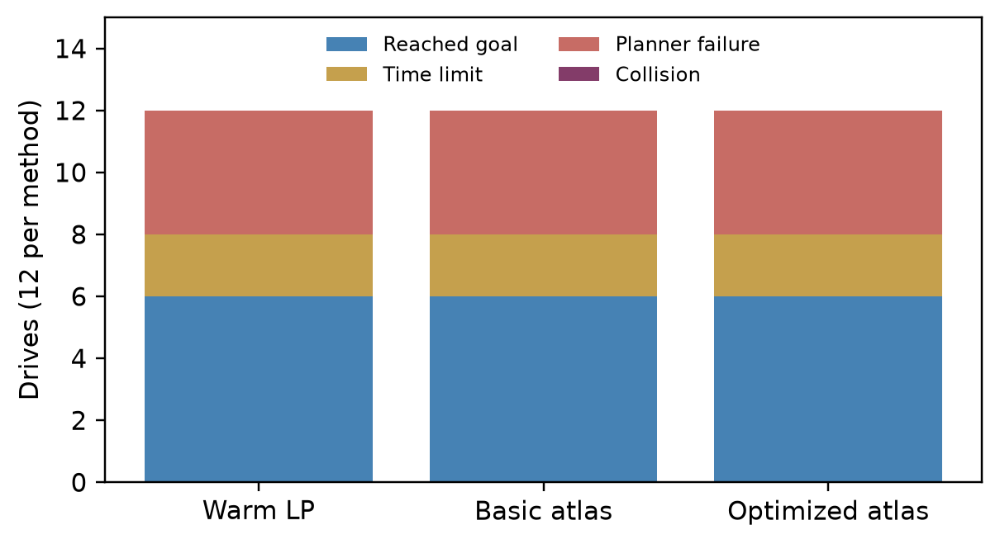
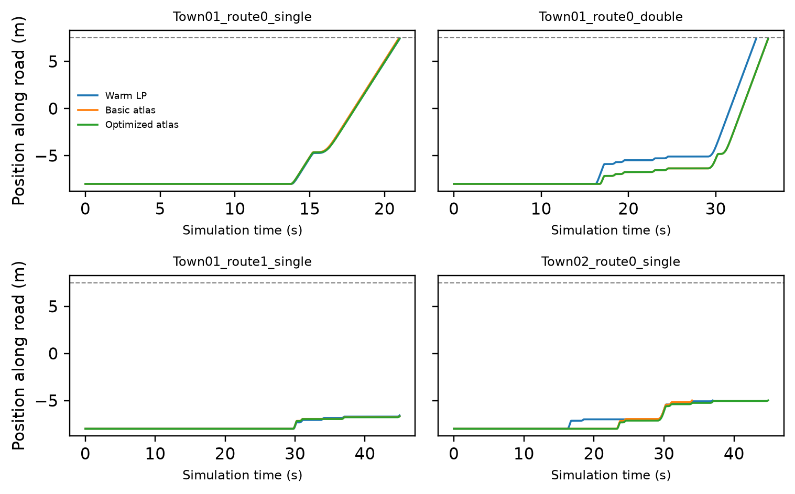
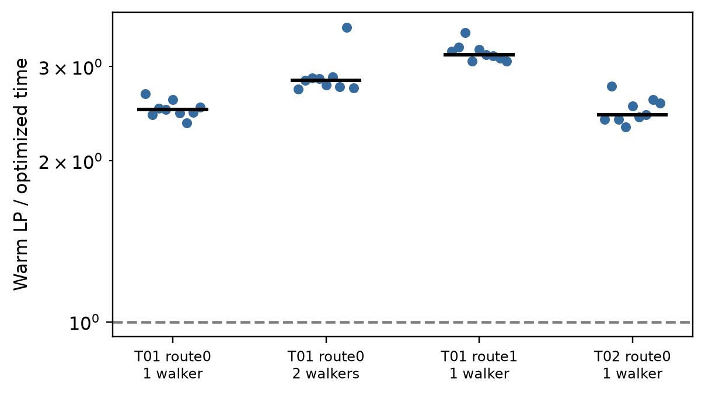

# 优化算法接入 CARLA 闭环驾驶：结果与边界

本批实际启动CARLA 0.9.16，实时读取行人与车辆位置，更新风险和起点，规划后向车辆发送油门/制动，再用车辆的新位置继续规划。它是仿真闭环驾驶，而不是只对旧观测文件做回放。低层仍为直路前进/等待控制。

## 实验设计

Town01的路线0单行人/双行人、路线1单行人，以及Town02路线0单行人，共4个场景。每场景使用3个固定动作种子，对比优化图谱、基础图谱和保基LP，共36次驾驶。算法沿用2026-10-26版本，风险预算和目标差门槛未放宽。每次驾驶启动全新服务器和客户进程。方法执行顺序预先打乱，完整协议见[PROTOCOL_CN.md](PROTOCOL_CN.md)。

所有规划调用（含失败调用）均计时，初始化计入首次查询；公共建模、仿真推进、策略存盘、独立核验不计入规划耗时。以下驾驶耗时来自不同闭环轨迹，不能直接解释为同输入的求解器加速比。

## 驾驶结果

| 方法 | 到达终点 | 到时未到达 | 规划失败 | 碰撞 | 查询数（含失败） | 单次驾驶累计规划耗时中位数/s |
|---|---:|---:|---:|---:|---:|---:|
| 保基LP | 6 | 2 | 4 | 0 | 7358 | 6.768 |
| 基础图谱 | 6 | 2 | 4 | 0 | 7515 | 4.148 |
| 优化图谱 | 6 | 2 | 4 | 0 | 7855 | 3.462 |

各场景分别看：

| 场景 | 保基LP | 基础图谱 | 优化图谱 |
|---|---|---|---|
| Town01_route0_single | 3次到达 | 3次到达 | 3次到达 |
| Town01_route0_double | 3次到达 | 3次到达 | 3次到达 |
| Town01_route1_single | 2次超时，1次规划失败 | 2次超时，1次规划失败 | 2次超时，1次规划失败 |
| Town02_route0_single | 3次规划失败 | 3次规划失败 | 3次规划失败 |

三种方法的驾驶结局计数相同：各6/12次到达、2次超时、4次规划失败、0次记录到碰撞。因此，本批没有观察到优化方法提高驾驶成功率。它的作用应定位为减少规划计算，而非解决既有控制器的全部驾驶问题。



到达终点、数值证书通过和计算更快是三个不同指标。规划失败表示该时刻未返回合格策略；实验立即停止正常驾驶，尚未实现经过验证的紧急接管。到时未到达也保留在分母内。三次种子重复不足以估计实际道路事故概率。



上图固定展示每场景第0次重复，包含所有三种方法，未按是否到达选择轨迹。横轴是仿真时间；曲线提前结束可能是到达、规划失败或碰撞，具体结局见[逐次驾驶表](driving_summary.csv)。

## 相同输入下是否更快

为排除驾驶路径不同带来的影响，预先指定每场景、每种驾驶方法第0次重复的输入，共12条序列。所有已返回查询的前缀都保留，原驾驶失败也不删除。关闭模拟器后，优化方法与保基LP依次处理相同风险和起点，各计时3次，共72次运行、36次配对。失败前缀上的计算优势不能替代完整驾驶成功。

有效配对36/36次，其中优化方法更快36次，不快于LP 0次。LP/优化耗时比中位数为2.730，范围为2.312–3.555。这是本批固定输入上的测量结果，重复计时不是新增独立场景。



图中每点为一次配对，比值大于1表示优化方法更快，黑线为中位数。详见[配对数据](replay_pairs.csv)。

补充分析：发现最大延迟出现在未返回查询后，对上述12条输入中全部3条失败驾驶序列，再计入最终失败查询的耗时，各重复3次，共9次配对。优化方法更快9/9次，耗时比中位数为2.045，范围1.973–2.231。这项分析在查看闭环延迟后追加，属于事后补充，不与预定36次配对混合。详见[含失败查询的配对表](failure_inclusive_pairs.csv)。

## 延迟与数值核验

| 方法 | 查询P50/ms | P95/ms | 最大/ms | 超过50ms次数 |
|---|---:|---:|---:|---:|
| 保基LP | 15.001 | 18.811 | 494.088 | 41 |
| 基础图谱 | 3.704 | 8.198 | 1082.357 | 53 |
| 优化图谱 | 3.728 | 8.516 | 1417.552 | 17 |

优化方法仍有17/7855次查询超过50ms，最长约1.418秒，发生在未返回策略的失败查询。因此，累计计算更快不代表每次查询都更快，也不代表已具备严格实时保证。

已独立读取并核验22716个实际返回的完整策略，另诊断12个未返回查询；核验异常数为0。检查包括策略文件哈希、动作概率、实际采样动作、占据分布流平衡、风险预算、目标值重算和独立LP上下界。完整结果见[核验汇总](validation/audit.json)，失败点的新建LP诊断见[summary.json](summary.json)。

这些是浮点数值证据，不是精确算术证明。风险上限约束的是离散模型中的期望折扣风险，并不直接等于真实碰撞概率。固定0.05秒仿真步长也不代表墙钟下已达到严格20Hz实时控制。

12个未返回查询中，全新建立的LP有12个得到Infeasible状态。这表明这些失败不能简单归因于策略复用太慢；起点随车辆移动后，原风险预算可能已无法满足。当前执行层尚未保证下一时刻仍有可行方案。失败后停止仿真并不等于实现了安全停车，因此零记录碰撞也不能解释为完整驾驶安全保证。

## 可以写入论文的结论与限制

本批将优化算法接入了实际运行的CARLA闭环，并通过保存完整策略及实际采样动作，使模型证书与执行接口可以事后核对。计算效率应依据同输入回放的配对结果；驾驶能力应依据全部36次的到达、超时、失败和碰撞统计，不能互相替代。

当前仍是固定车道、直路前进/等待和预设行人条件，风险输入使用CARLA对象的真值坐标，不是摄像头感知系统。沿用的起点映射每次将任务历史位归零，因此不能宣称已完成完整LTL历史监控；风险映射与连续控制之间也尚无校准的安全保证。下一步应完善任务状态跟踪、规划不可行时的安全接管、更多独立道路与行人行为、实时延迟控制，以及长时间策略库增长测试。

基础设施异常共记录4次尝试，保存在diagnostics；不会将其当作策略成功或隐去。开发期一次地图重载后发生CARLA访问冲突，正式协议因而采用每次新进程。正式运行未因驾驶结局重跑。

另有2次驾驶通过公开修订的基础设施恢复阶段补齐。原失败尝试和补测清单都保留，详见[协议修订说明](PROTOCOL_AMENDMENTS_CN.md)。原矩阵的重试上限曾增加，不能表述为全程没有协议调整；冻结的规划算法、风险门槛和场景种子未变。

## 复现与文件

运行环境与冻结源文件哈希见[run_manifest.json](run_manifest.json)，逐次驾驶在results，完整策略NPY压缩包在policies，服务器与客户日志在server_logs和logs。核验与绘图都在计时之后运行。

核验本批存档并重新生成图表：

```bash
python verify_artifacts.py
python analyze.py
```

重新驾驶时请指定新的输出目录，避免覆盖本批记录；示例：

```bash
python run_suite.py --server /path/to/CarlaUE4.exe --out ./new_run --infra-retries 1
python validate_results.py --results-dir ./new_run/results --out ./new_run/validation
python replay.py --results-dir ./new_run/results --out ./new_run/replays
```

本批事后补充计时入口是replay_failure_inclusive.py，默认读取本批results并重写failure_inclusive，请在独立仓库副本中重跑。analyze.py默认汇总本批保留的数据。若新驾驶出现基础设施缺测，先按协议修订说明运行recover_missing.py并指定相同的--out及--server；完整驾驶失败不可重试。

请在完整仓库中、本实验目录下执行，安装requirements.txt所列依赖；Linux服务器路径可替换。服务器启动和地图加载不计入规划耗时。EPS图片可用于现有CCC的LaTeX编译链。文件校验清单为SHA256SUMS.txt。
